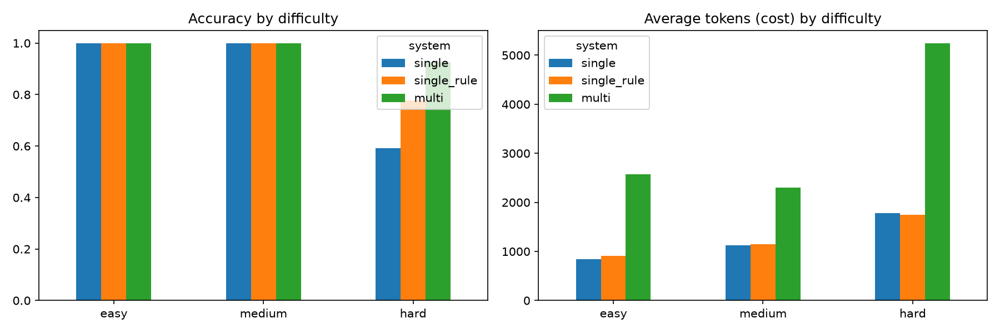

# Single vs. Multi-Agent LLM Systems on Workplace Tasks

A small empirical study comparing a single tool-using LLM agent with a multi-agent team (Planner → Worker → Checker) on simple workplace tasks, measuring accuracy, cost, and failure patterns.

**Author:** [Your Name] · **Date:** [Month Year] · **Model:** gpt-4o-mini (OpenAI)

---

## Research Question

> When does a team of AI agents do better than a single agent, and is the extra cost worth it?

Many teams assume multi-agent systems are always better. They also cost more and introduce new failure modes. This study tests the question on a controlled set of office-style tasks.

---

## Setup

### Environment
A small synthetic "office" of 5 files in `data/`:

| File | Contents |
|------|----------|
| `sales.csv` | Revenue by region and month |
| `emails.txt` | Two short emails (meeting change, budget update) |
| `employees.csv` | Names, departments, salaries |
| `calendar.csv` | Meeting dates, times, rooms |
| `inventory.csv` | Office items, quantities, unit prices |

Synthetic data was used so every answer is known, no private data is shared, and the study can be reproduced.

### Tools (shared by all systems)
- `list_files()` — list files in the data folder
- `read_file(filename)` — return a file's contents
- `calculator(expression)` — safe arithmetic (no `eval`)

### Systems compared
All systems use the **same model, same tools, and same step limit**.

| System | Description |
|--------|-------------|
| **single** | One agent with tools in a think → act → observe loop (max 8 steps) |
| **single_rule** | Same as `single`, plus one sentence from the Planner: *"If you are not sure which file has the information, read every file."* |
| **multi** | Planner writes a plan → Worker executes it with tools → Checker reviews the tool results and answer (max 3 retries) |

`single_rule` was added to separate the effect of the **team structure** from the effect of the **Planner's instruction**.

### Tasks
30 tasks with hand-checked answers (`tasks/tasks.json`):
- **10 easy** — one file, one fact
- **10 medium** — one file, a calculation
- **10 hard** — multiple files, multiple steps, or information in an unexpected file

### Procedure
Each system ran every task **3 times** (270 runs total). Answers were scored automatically by checking whether the normalized correct answer appears in the agent's reply. Tokens, steps, and time were recorded, and full traces were saved to `results/logs/` for failure analysis.

---

## Results

### Two ambiguous tasks
Failure analysis showed two tasks were ambiguous:
- **Task 19** (average Furniture unit price): agents computed a quantity-weighted average (175.76) instead of a simple average (235). Both are reasonable readings.
- **Task 26**: every run of every system read "total revenue of the region" as that region's January revenue, giving 2,450 instead of 19,450.

Results are reported **with all 30 tasks** and **without these 2 tasks** (28 clear tasks).

### Accuracy — all 30 tasks

| Difficulty | single | multi |
|------------|--------|-------|
| Easy | 100% | 100% |
| Medium | 90% | 100% |
| Hard | 53% | 83% |
| **Overall** | **81%** | **94%** |

### Accuracy and cost — 28 clear tasks

| Difficulty | single | single_rule | multi |
|------------|--------|-------------|-------|
| Easy — accuracy | 100% | 100% | 100% |
| Easy — avg tokens | 846 | 910 | 2,572 |
| Medium — accuracy | 100% | 100% | 100% |
| Medium — avg tokens | 1,123 | 1,146 | 2,298 |
| **Hard — accuracy** | **59%** | **78%** | **93%** |
| Hard — avg tokens | 1,776 | 1,749 | 5,246 |

### Cost per correct answer (hard tasks)

| System | Tokens per correct answer |
|--------|---------------------------|
| single | ~3,010 |
| single_rule | **~2,240** |
| multi | ~5,640 |



### Failure analysis (hard tasks, clear set)

| Failure type | single | single_rule | multi |
|--------------|--------|-------------|-------|
| Skipped the file with the answer | 6 | 1 | 1 |
| Asked the user instead of searching | 3 | 2 | 0 |
| Used the wrong data (confident wrong answer) | 0 | 3 | 0 |
| Other (math error, step limit) | 2 | 0 | 1 |
| **Total failures (of 27 runs)** | **11** | **6** | **2** |

---

## Key Findings

1. **On easy and medium tasks, a team adds cost without adding accuracy.** All systems scored 100%, but the team used 2–3× more tokens.
2. **On hard tasks, the team was most accurate** (93% vs. 59% for the single agent).
3. **A single instruction explained more than half of the team's advantage.** Adding the Planner's rule to the single agent raised hard-task accuracy from 59% to 78% with no extra token cost.
4. **The single agent's main weakness was not checking the right file.** Most of its failures came from skipping `emails.txt` or asking the user instead of searching.
5. **The type of error matters.** With the added rule, the single agent sometimes replaced an honest "I can't find it" with a confident wrong answer (e.g., using total sales revenue as the marketing budget). The team's Checker, which sees the tool results, avoided this.

**Practical takeaway:** start with a single agent and clear instructions; use a multi-agent team when tasks are hard and wrong answers are costly.

---

## Pilot Changes (before the final experiment)

The design was frozen after a pilot on 5 tasks. Two changes were made during the pilot:
1. **Checker given evidence.** Originally the Checker saw only tool *names*, not results, so it repeatedly rejected correct answers (e.g., ~7,000 tokens instead of ~2,400 on one task). It now sees the tool results.
2. **Reply parsing fixed.** The code originally accepted the Checker's approval only if the reply *started* with "OK"; it now also accepts "OK" at the end.

---

## Limitations

- **Small sample:** 30 tasks, 3 runs each. Differences on hard tasks rest on 27 runs per system, so results suggest patterns rather than prove them.
- **Synthetic, small data:** real workplace files are larger, messier, and more numerous.
- **One model:** results may differ for other models (e.g., Claude or larger GPT models).
- **Simple scoring:** substring matching can miss correct answers phrased differently or accept wrong ones; all failures were checked by hand.
- **Prompt design:** the Planner, Worker, and Checker prompts were written once; different prompts could change results.
- **Task authorship:** tasks were written by the author, and two turned out to be ambiguous.

---

## Possible Next Steps

- Increase to 100+ tasks and 5+ runs per task
- Test additional models (e.g., Claude, larger GPT models)
- Evaluate on an established benchmark of agent tasks
- Test a Checker-only variant (single agent + Checker, no Planner) to isolate each role's contribution

---

## Repository Structure

```
├── data/                    # Synthetic office files
├── tasks/tasks.json         # 30 tasks with answers and difficulty
├── tools.py                 # list_files, read_file, calculator
├── agents/
│   ├── single_agent.py      # Single agent
│   ├── single_agent_rule.py # Single agent + Planner's rule
│   └── multi_agent.py       # Planner → Worker → Checker
├── results/
│   ├── results.csv          # All runs
│   ├── charts.png           # Accuracy and cost charts
│   └── logs/                # Full trace of every run
└── experiment.ipynb         # Experiment and analysis notebook
```

## How to Run

1. Install: `pip install openai python-dotenv pandas matplotlib`
2. Create a `.env` file with `OPENAI_API_KEY=your-key`
3. Open `experiment.ipynb` and run the cells in order

The full experiment (270 runs) cost under $2 with gpt-4o-mini.
